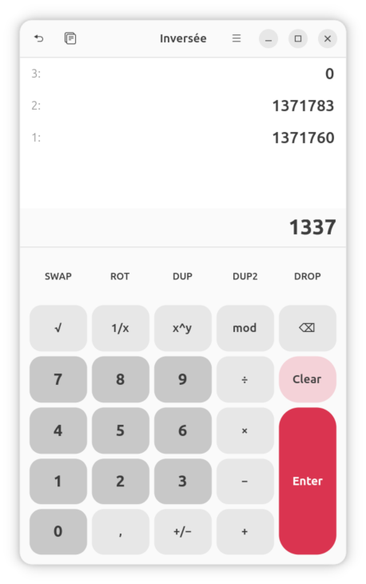
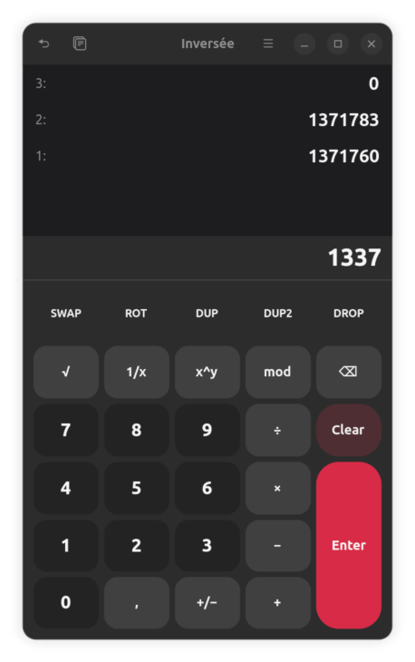

# inversée

A Reverse Polish Notation (*Polonaise inversée*) calculator for Linux,
built to look and feel like a native GNOME application.

> **inversée** \\ɛ̃.vɛʁ.se\\  
> French, past participle, feminine singular, of "inverser".

<p align="center">
  
  
</p>

## Install

```sh
curl -L -o /tmp/inversee.flatpak \
    https://github.com/benjaminbellamy/inversee/releases/download/1.3.1/inversee-1.3.1.flatpak \
    && flatpak install --user --bundle /tmp/inversee.flatpak
```

## Features

- **Unbounded stack** (Forth/dc-style); every level is visible at once.
- **Arbitrary-precision arithmetic** via MPFR (128-bit internal precision,
  ~38 decimal digits).
- **Adwaita / GTK 4** interface, follows the system light/dark theme and accent.
- **Full RPN operation set**: `+`, `−`, `×`, `÷`, `mod`, `%`, `x^y`, `√`, `1/x`,
  `+/−`; stack ops `swap`, `drop`, `rot`, `dup`, `dup2`, `clear`.
- **Unbounded undo** (capped at 1000 entries per session).
- **Configurable number format** (see below): pick Automatic, the system
  convention, or a fixed one (`1,234.56`, `1 234,56`, `1.234,56`) for display,
  copy, and paste — applied live, no restart.
- **Tolerant clipboard paste**: ignores currency symbols, units, and labels
  around a number, accepts thin / non-breaking thousands separators, smart
  digit grouping, scientific notation, and both decimal separators.
- **Clipboard**: copy X, copy the whole stack (one value per line), paste a
  list of values separated by `;`, newlines, or tabs.
- **Translations**: English (source), French, German, Italian, Spanish,
  Dutch, Polish, Portuguese — switchable from the in-app menu.
- **Fully offline** — no network access, no telemetry.

## Usage

Inversée uses [Reverse Polish Notation][rpn] (RPN): operands first, then the
operator. Devised by Polish logician Jan Łukasiewicz in the 1920s and made
famous by Hewlett-Packard pocket calculators, RPN makes parentheses
unnecessary — the machine evaluates expressions left to right exactly the way
you type them.

To compute `2 + 3`: type `2`, press **Enter**, type `3`, press `+`. The stack
shows `5`. The whole stack stays visible; the newest value, labelled `1:`, is
the top, and operators consume from the top down. Reorder with `swap`, `drop`
and `rot`, undo any change with **Ctrl+Z** (redo with **Ctrl+Shift+Z**), and
click any stack value to copy it. The in-app **About Inversée** entry shows
the same quick-start, and **Keyboard Shortcuts** lists every key.

[rpn]: https://en.wikipedia.org/wiki/Reverse_Polish_notation

## Status

Released. Core engine and UI work end-to-end; the stack and undo
history persist across launches.

## Keyboard shortcuts

| Key                | Action                                  |
|--------------------|-----------------------------------------|
| `0`–`9`            | Digit entry                             |
| `.` or `,`         | Decimal separator (locale-tolerant)     |
| `Enter`            | Push entry / duplicate X                |
| `Backspace`        | Delete last char / drop X               |
| `+` `−` `×` `÷`    | Arithmetic                              |
| `%` / `^`          | Percent of / power (`x^y`)              |
| `r` / `i` / `n`    | Square root / inverse `1/x` / negate    |
| `m` / `s` / `d` / `t` | mod / swap / drop / rot              |
| `Escape`           | Clear stack                             |
| `Ctrl+Z`           | Undo                                    |
| `Ctrl+C` / `Ctrl+V`| Copy X / paste                          |
| `Ctrl+Shift+C`     | Copy entire stack                       |
| `F10`              | Open the main menu                      |

The same shortcuts are reachable from the on-screen keypad and the
hamburger menu's **Keyboard Shortcuts** dialog.

### Using your keyboard's Calculator key

Many keyboards expose a Calculator key that GNOME binds to
`gnome-calculator` by default. To use Inversée instead, open the
hamburger menu and pick **Reassign calculator key…** — the dialog
walks you through GNOME Settings → Keyboard, clearing the existing
Launch Calculator shortcut and adding a Custom Shortcut that runs
Inversée when you press the key.

## Number format

The hamburger menu's **Number format** submenu picks the decimal separator,
thousands separator, and clipboard behaviour for display, copy, and paste at
once. Stored values are unaffected, and the change applies live.

The default **Automatic** mode is the one to keep in everyday use. Display
and copy follow your system locale, while paste stays *tolerant*: it accepts
either decimal separator, strips currency symbols, units, and labels around
a number, handles smart digit grouping, and reads scientific notation. So a
value copied from a PDF, a spreadsheet, or a web page that uses another
locale just works — no re-typing or clean-up needed.

| Choice        | Example     | Behaviour                                          |
|---------------|-------------|----------------------------------------------------|
| **Automatic** | (default)   | Display and copy follow the system locale; paste is best-effort across conventions. |
| **System**    | shows yours | Display, copy, and paste all follow the system locale strictly. |
| `1,234.56`    | US / UK     | Period decimal, comma grouping.                    |
| `1 234,56`    | French      | Comma decimal, narrow-space grouping.              |
| `1.234,56`    | German, Spanish, Italian, Dutch, Polish, Portuguese | Comma decimal, period grouping. |

Concretely, in Automatic mode:

- Leading or trailing non-numeric characters (currency symbols, units,
  labels) are ignored: `Total: 1,234.56 €` → `1234.56`.
- Values are separated by `;`, newlines, or tabs. A bare space is a thousands
  separator when it groups three digits (`304 650` → `304650`) but separates
  values otherwise (`1 2 3` → three values).
- In **Automatic** mode, when a number contains both `.` and `,` the rightmost
  is the decimal point, so `1,234.56` and `1.234,56` both read correctly. A
  lone comma is a decimal point only when your locale uses one.

## Build

### Local (host)

Requires `meson`, `ninja`, `valac`, `gettext`, plus the development headers
for GLib, GTK 4, libadwaita, MPFR, and json-glib.

```sh
meson setup build
meson compile -C build
meson test -C build --print-errorlogs
./build/src/inversee
```

The binary can be run uninstalled directly from the build tree —
translations, the GSettings schema, and the application icon are all
discovered from the build directory when launched that way.

### Flatpak

The Flatpak manifest is the canonical build reference.

```sh
flatpak-builder --user --install --force-clean \
    build-flatpak build-aux/fr.benjaminbellamy.Inversee.yaml
flatpak run fr.benjaminbellamy.Inversee
```

## Tests

The numeric and stack engine is a pure-logic static library
(`libinversee-core`) with no GTK dependency. It ships with GLib-based
test binaries for every module:

```sh
meson test -C build --print-errorlogs
```

## License

GPL-3.0-or-later. See [LICENSE](LICENSE).

## Author

Benjamin Bellamy &lt;benjamin@castopod.org&gt;
